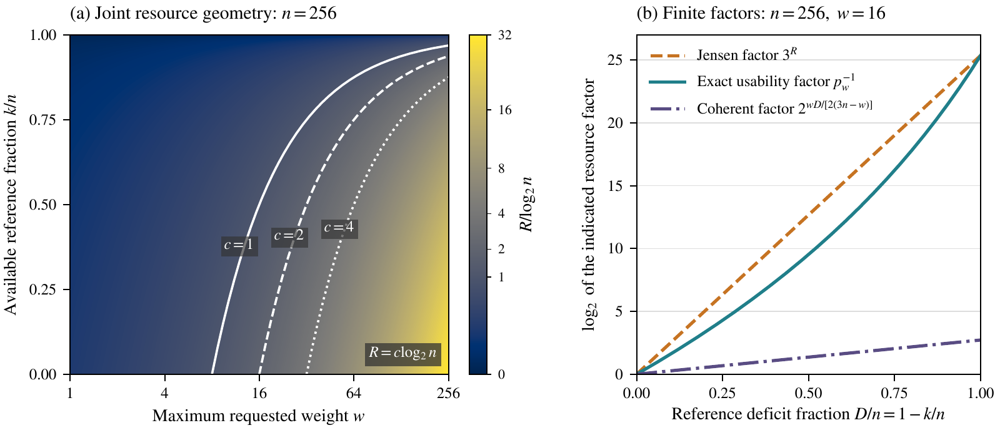

# Analytical resource regimes

This figure shows how the requested Pauli weight and the coherent reference budget enter the learning bounds. Its scalar parameter is $`R=w(n-k)/n`$, where $`n`$ is the number of channel-input qubits, $`k`$ counts the coherent qubits outside that register at every invocation, and $`w`$ is the largest requested weight.



[Vector PDF](Graph/resource_regimes.pdf) · [Python generator](generate_resource_regimes.py)

## Reproduce

From the repository root, with Python 3.11 or later:

```bash
python3 -m pip install -r figures/requirements.txt
python3 figures/generate_resource_regimes.py
```

The generator writes `figures/Graph/resource_regimes.pdf`. Its output path is relative to the generator, so the script also works when called from another directory. The recorded environment uses Python 3.12.14, NumPy 2.3.5, and Matplotlib 3.10.8. The numerical and plotting dependencies are pinned in [requirements.txt](requirements.txt).

The PNG shown above is a rendered preview of the vector PDF. With Poppler installed, it can be regenerated from the repository root:

```bash
pdftoppm -scale-to 1600 -singlefile -png \
  figures/Graph/resource_regimes.pdf figures/Graph/resource_regimes
```

## Panels and formulas

**Panel (a): joint resource geometry.** Fix $`n=256`$. The color field is evaluated for every integer $`1\leq w\leq256`$ and $`0\leq k\leq256`$ and displayed with filled contours. Color gives $`R/\log_2n`$. The horizontal weight axis is logarithmic; the vertical axis is the available reference fraction $`k/n`$. The white curves show

```math
R=c\log_2n,\qquad
\frac{k}{n}=1-\frac{c\log_2n}{w},\qquad c\in\{1,2,4\}.
```

These are illustrative finite-parameter levels. The proved polynomial-query criterion is the asymptotic condition $`R=O(\log n)`$ at fixed nontrivial accuracy and confidence for the complete weight-bounded Pauli family. No selected contour is a finite-size transition.

**Panel (b): finite resource factors.** Fix $`n=256`$ and $`w=16`$, and vary the integer deficit $`D=n-k`$ from zero to $`256`$. For the partial-Bell construction, the exact usability probability is

```math
p_w=\frac{1}{\binom nw}
\sum_{m=0}^{w}\binom Dm\binom{k}{w-m}3^{-m},
```

where an out-of-range binomial coefficient is zero. The generator evaluates this probability with exact integer arithmetic and rational reduction before taking logarithms. The three displayed quantities are

```math
\log_2(p_w^{-1}),\qquad
\log_2(3^R),\qquad
\log_2\!\left(2^{wD/[2(3n-w)]}\right).
```

The first is the usability factor in the constructive bound; the second is its Jensen upper bound; the third is the exponential factor in the coherent converse. The full bounds also contain accuracy, confidence, and target-count factors. These plotted factors do not specify optimal channel-call counts or matching exponential constants. Every curve is an analytical evaluation, without fitted parameters or simulated data.

At $`D=0`$, every record is usable and all three logarithms vanish. At $`D=n`$, $`p_w=3^{-w}`$ and the first two curves coincide. For the displayed $`w=16`$, their endpoint is $`16\log_2 3\approx25.3594`$; the coherent factor has endpoint exponent $`128/47\approx2.7234`$.

## Scientific sources

- [Model and tasks](../science/model.md): the channel, full coherent-width budget, and late-index learning contract.
- [Partial-Bell protocol](../science/partial_bell.md#exact-usability-probability): the exact usability probability and its Jensen bound; the following sections give the estimator, confidence guarantee, and resource accounting.
- [Coherent-memory converse](../science/coherent_memory.md#statement-and-resource-contract): Theorem C1 and its finite exponential factor.
- [Polynomial query frontier](../science/coherent_memory.md#polynomial-query-frontier): the asymptotic weight–memory criterion and its accuracy/confidence assumptions.
